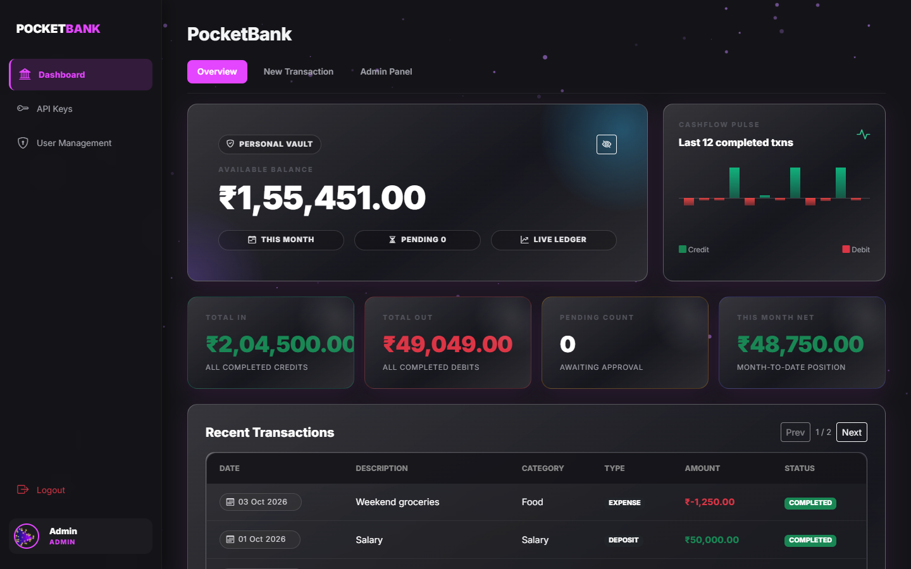
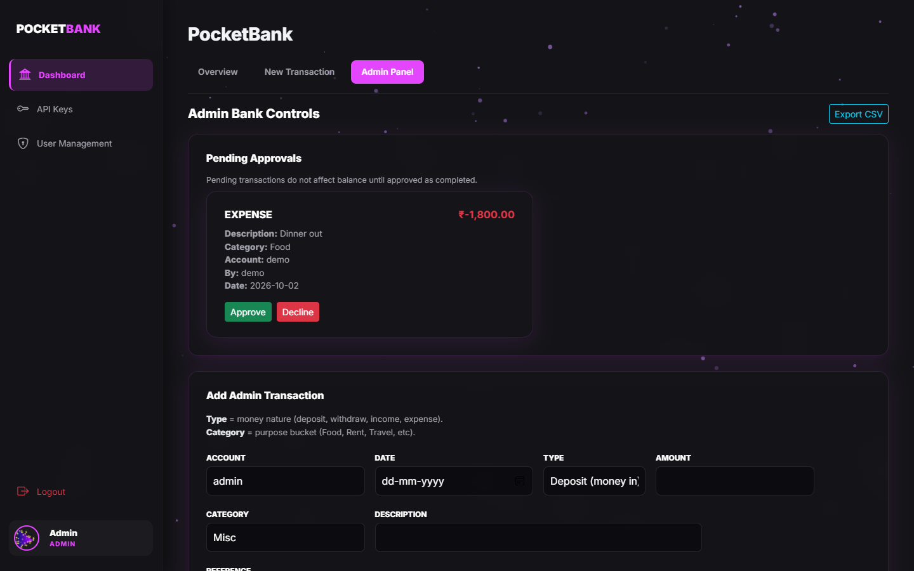
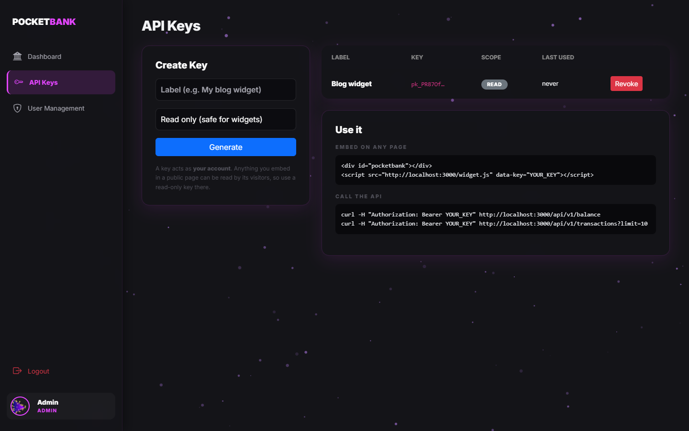
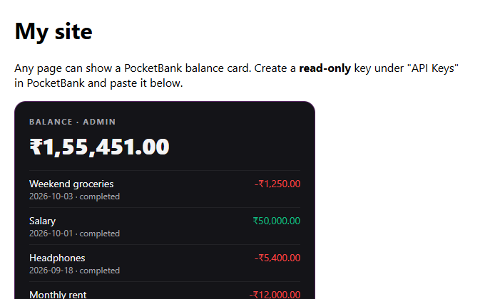

# PocketBank

[](https://github.com/laalaalaee/pocketbank/actions/workflows/ci.yml)

A small, self-hostable ledger. Each user has their own account, transactions go through an approval step, and there is a JSON API plus a one-line widget so other sites can show a balance. Express, Nunjucks and plain JSON files: no database to set up.



## Quickstart

```bash
git clone https://github.com/laalaalaee/pocketbank.git
cd pocketbank
npm install
cp .env.example .env      # set SESSION_SECRET
npm run seed              # demo users and transactions
npm start                 # http://localhost:3000
```

Or with Docker: `docker compose up` (seeds demo data on first run).

**Demo logins** (created by the seed script, change them before deploying anywhere public):

| User | Password | Role |
|---|---|---|
| `admin` | `admin123` | admin |
| `demo` | `demo123` | user |

Use `ADMIN_PASSWORD=... npm run seed` to pick your own admin password. The server prints a warning at startup while a demo password is still in use.

## What it does

- Per-user accounts: everyone sees their own balance and transactions
- Deposits and withdrawals start as **pending**; an admin approves or declines them, and only approved ones change the balance
- Admin panel: add, edit and delete transactions on any account, approve the queue, export CSV
- User management: create users, reset passwords, promote or demote, remove
- API keys (read-only or read+write), a JSON API and an embeddable widget
- Money is summed in integer paise, so balances never drift

| Admin panel | API keys |
|---|---|
|  |  |

## API

Create a key under **API Keys** in the app. It is shown once and stored hashed. A key acts as the account that created it.

```bash
curl -H "Authorization: Bearer pk_..." http://localhost:3000/api/v1/balance
```
```json
{ "account": "demo", "currency": "INR", "balance": 6250.5, "total_in": 8000, "total_out": 1749.5, "pending_count": 1 }
```

| Method | Path | Scope | Description |
|---|---|---|---|
| GET | `/api/v1/balance` | read | Balance and totals for the key's account |
| GET | `/api/v1/transactions?limit=20&status=completed` | read | Latest transactions (max 100) |
| POST | `/api/v1/transactions` | write | Create a **pending** transaction |

```bash
curl -X POST http://localhost:3000/api/v1/transactions \
  -H "Authorization: Bearer pk_..." -H "Content-Type: application/json" \
  -d '{"type":"deposit","amount":500,"description":"Top up","category":"Savings"}'
```

`type` is `deposit` or `withdraw`, `amount` is a positive number. Errors are JSON: `{ "error": "..." }` with status 400, 401, 403 or 429 (120 requests per minute per key).

## Embed on a website

```html
<div id="pocketbank"></div>
<script src="https://YOUR_HOST/widget.js" data-key="pk_READ_ONLY_KEY"></script>
```



Optional attributes: `data-target` (element id, default `pocketbank`) and `data-limit` (rows, default 5). See [examples/embed.html](examples/embed.html). Anything in a public page is visible to its visitors, so **use a read-only key**.

## Configuration

| Variable | Default | |
|---|---|---|
| `PORT` | `3000` | |
| `SESSION_SECRET` | random per start | Set it, or sessions reset on every restart |
| `DATA_DIR` | `./data` | Where the JSON files live |
| `TRUST_PROXY` | `false` | Set `true` behind a reverse proxy so rate limits see real client IPs |
| `COOKIE_SECURE` | `false` | Set `true` when serving over HTTPS |

## Development

```bash
npm test     # ledger rules, auth, API keys, rate limiting, cross-site protection
npm run dev  # restart on change
```

Layout: `app.js` (routes), `lib/` (ledger maths, storage, rate limiter), `templates/`, `public/widget.js`, `scripts/seed.js`, `test/`. Why things are built the way they are: [DECISIONS.md](DECISIONS.md).

## Background

This started in early 2026 as the treasury module of Playstorm Esports Club's internal management system at Amity University, which handled data for 1,200+ members. At the time the work lived in zip files and a hosting panel rather than git, so the first commit here is the extracted original. The per-user accounts, API, widget, tests and Docker setup were added in October 2026 and are dated accordingly.

## Roadmap

- [ ] SQLite storage
- [ ] Transfers between accounts
- [ ] Monthly statements and charts
- [ ] Spending categorisation and insights
- [ ] Per-session CSRF tokens
